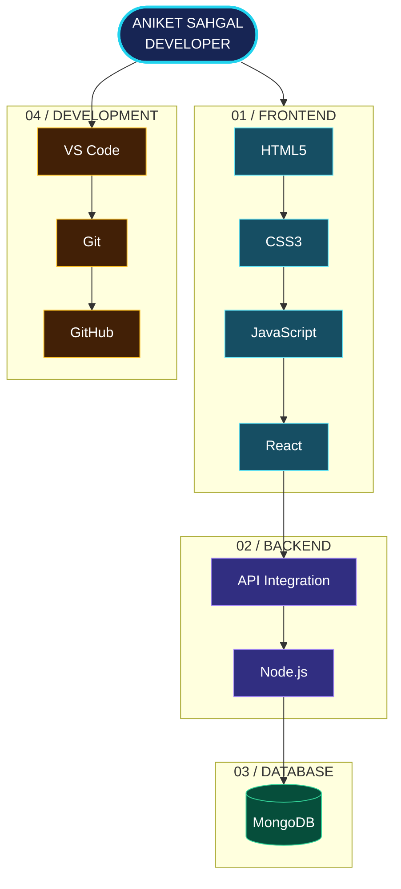

 

---

## ◈ 01. ABOUT ME

Hello! I'm **Aniket Sahgal**, a Computer Science Engineering student passionate about software development and building interactive web applications.

- 🎓 B.Tech Computer Science Engineering (2022–2026)
- 💻 Interested in Full Stack Development
- 🌱 Exploring modern web technologies
- 🚀 Building practical and responsive applications
- 🎯 Improving programming and problem-solving skills

---

## ◈ 02. TECHNICAL ARCHITECTURE

---

## ◈ 03. TECHNOLOGY STACK

### FRONTEND

### BACKEND & DATABASE

### TOOLS

---

## ◈ 04. FEATURED PROJECTS

<table>
<tr>
<td width="50%" valign="top">

### 🌦️ Weather Forecast

Weather forecasting web application using JavaScript.

**Features**
- Weather information
- Interactive interface
- Responsive design

<a href="https://weather-forecast-omega-dusky.vercel.app/">LIVE DEMO ↗</a>

</td>
<td width="50%" valign="top">

### 🍔 Food Recipe

Responsive food recipe website built using HTML, CSS and JavaScript.

**Features**
- Categorized recipes
- Recipe search
- Clean user interface

<a href="https://sehgal1001.github.io/Food_Recipie/">LIVE DEMO ↗</a>

</td>
</tr>
</table>

---

## ◈ 05. GITHUB ANALYTICS

 

---

## ◈ 06. CONNECT WITH ME

### BUILD • LEARN • INNOVATE

