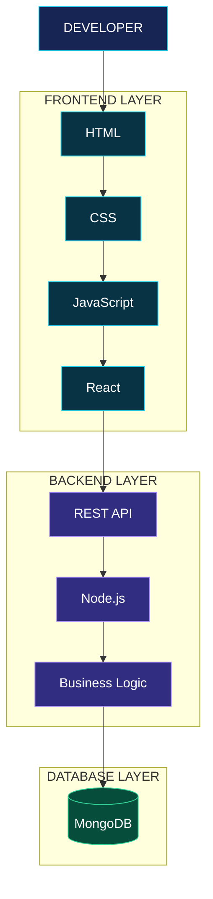

<div align="center">

<!-- Developer Header -->


<br/>


<br/>


</div>

---

<!-- ABOUT -->

## `01. ABOUT_ME`

```javascript
const aniket = {
    name: "Aniket Sahgal",
    username: "Sehgal1001",
    role: "Full Stack Developer",
    education: "B.Tech CSE (2022-2026)",

    interests: [
        "Web Development",
        "Software Engineering",
        "Problem Solving",
        "Building Projects"
    ],

    currentlyLearning: [
        "React.js",
        "Node.js",
        "Backend Development"
    ],

    goal: "Build useful products and become a better engineer"
};

console.log("Welcome to my profile!");
```

---

## `02. TECH_STACK`

### Frontend Development

<p>

</p>

### Backend & Database

<p>

</p>

### Programming & Tools

<p>

</p>

---

## `03. SYSTEM_ARCHITECTURE`



---

## `04. FEATURED_PROJECTS`

<table>
<tr>
<td width="50%" valign="top">

### 🌦️ Weather Forecast

A JavaScript-based weather forecasting application.

- Weather information
- Interactive interface
- Responsive design

<a href="https://weather-forecast-omega-dusky.vercel.app/">

</a>

</td>
<td width="50%" valign="top">

### 🍔 Food Recipe

A responsive recipe website built using HTML, CSS and JavaScript.

- Categorized recipes
- Search functionality
- User-friendly interface

<a href="https://sehgal1001.github.io/Food_Recipie/">

</a>

</td>
</tr>
</table>

---

## `05. GITHUB_ANALYTICS`

<div align="center">


<br/>


</div>

---

## `06. CONNECT`

<div align="center">

<a href="https://www.linkedin.com/in/aniket-sahgal-297a67276">

</a>

<a href="https://github.com/Sehgal1001">

</a>

</div>

---

<div align="center">

```text
> SYSTEM STATUS : ONLINE
> DEVELOPER     : ANIKET SAHGAL
> MODE          : BUILDING
> NEXT GOAL     : CREATE SOMETHING AMAZING
```

### `while(alive) { code(); learn(); build(); }`

**Thanks for visiting my profile.**


</div>
