<!-- ========================================================= -->
<!--             ANIKET SAHGAL | GITHUB PROFILE                 -->
<!--       PREMIUM NEON DEVELOPER PROFILE + PROJECT SHOWCASE     -->
<!-- ========================================================= -->

<div align="center">

<!-- ================= PROFESSIONAL BANNER ================= -->

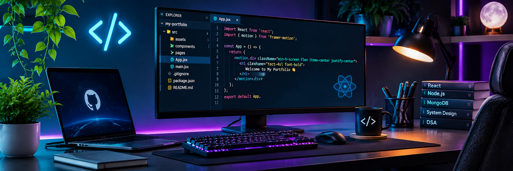

<br/><br/>


<br/>


<br/><br/>


<br/><br/>

**⚡ BUILD WITH PURPOSE · LEARN EVERY DAY · CREATE WHAT MATTERS**

</div>

---

<!-- ================= ABOUT ================= -->

<h2 align="center">✦ A LITTLE ABOUT ME</h2>

<div align="center">

</div>

<p align="center">
I'm <b>Aniket Sahgal</b>, a Computer Science Engineer and Full Stack Developer who enjoys turning ideas into useful, engaging web experiences.
</p>

<p align="center">
I like working across the frontend and backend — from shaping a clean interface to building the logic that makes an application work.
</p>

<div align="center">

<table>
<tr>
<td align="center" width="25%">
<h3>🎨</h3>
<b>Design</b>
<br/><sub>Clear, responsive interfaces</sub>
</td>

<td align="center" width="25%">
<h3>⚙️</h3>
<b>Develop</b>
<br/><sub>Useful web applications</sub>
</td>

<td align="center" width="25%">
<h3>🧩</h3>
<b>Problem Solve</b>
<br/><sub>Thoughtful solutions</sub>
</td>

<td align="center" width="25%">
<h3>🌱</h3>
<b>Keep Learning</b>
<br/><sub>Consistent improvement</sub>
</td>
</tr>
</table>

</div>

- 💻 Interested in full stack and modern web development.
- 🌱 Continuously learning and strengthening my development skills.
- 🛠️ Enjoy building projects and learning by doing.
- 🤝 Open to collaboration, feedback, and new opportunities.

---

<!-- ================= TECH STACK ================= -->

<h2 align="center">⚡ TECH STACK & TOOLKIT</h2>

<p align="center">
<i>Technologies and tools I use to design, build, and improve web applications.</i>
</p>

<br/>

<div align="center">

<table>
<tr>

<td align="center" width="50%">

<h3>01 · FRONTEND DEVELOPMENT</h3>


</td>

<td align="center" width="50%">

<h3>02 · BACKEND DEVELOPMENT</h3>


</td>

</tr>

<tr>

<td align="center" width="50%">

<h3>03 · DATABASES</h3>


</td>

<td align="center" width="50%">

<h3>04 · TOOLS & WORKFLOW</h3>


</td>

</tr>
</table>

</div>

<br/>

<div align="center">

</div>

---

<!-- ================= PROJECT SHOWCASE ================= -->

<h2 align="center">🚀 THE PROJECT TRAY</h2>

<p align="center">
<i>Selected builds — each one a step forward in my development journey.</i>
</p>

<div align="center">

<table>
<tr>

<!-- PROJECT 01 : WEATHER FORECAST -->

<td width="50%" align="center">

<a href="https://weather-forecast-omega-dusky.vercel.app/">

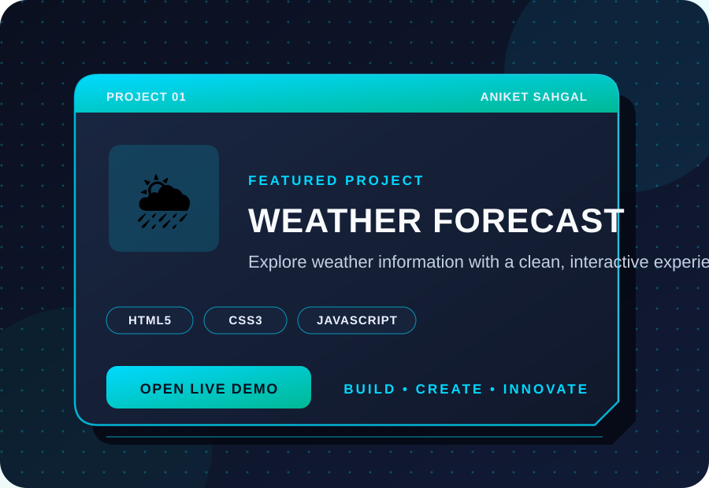

</a>

</td>

<!-- PROJECT 02 : FOOD RECIPE -->

<td width="50%" align="center">

<a href="https://sehgal1001.github.io/Food_Recipie/">


</a>

</td>

</tr>

<tr>

<!-- PROJECT 03 : SCIENTIFIC CALCULATOR -->

<td width="50%" align="center">

<a href="https://sehgal1001.github.io/scientific-calculator/">

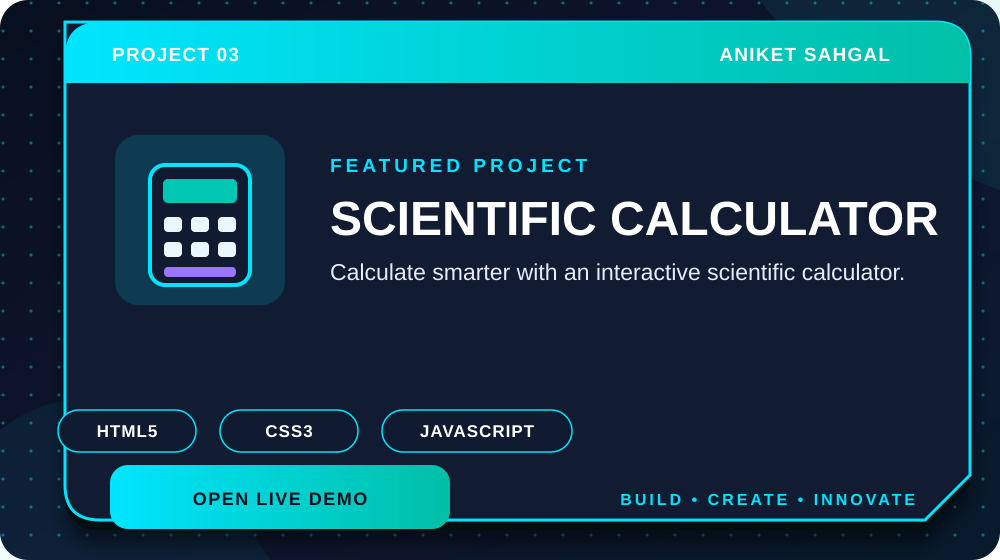

</a>

</td>

<!-- PROJECT 04 : ULTIMATE TIC TAC TOE -->

<td width="50%" align="center">

<a href="https://sehgal1001.github.io/ultimate-tic-tac-toe/">

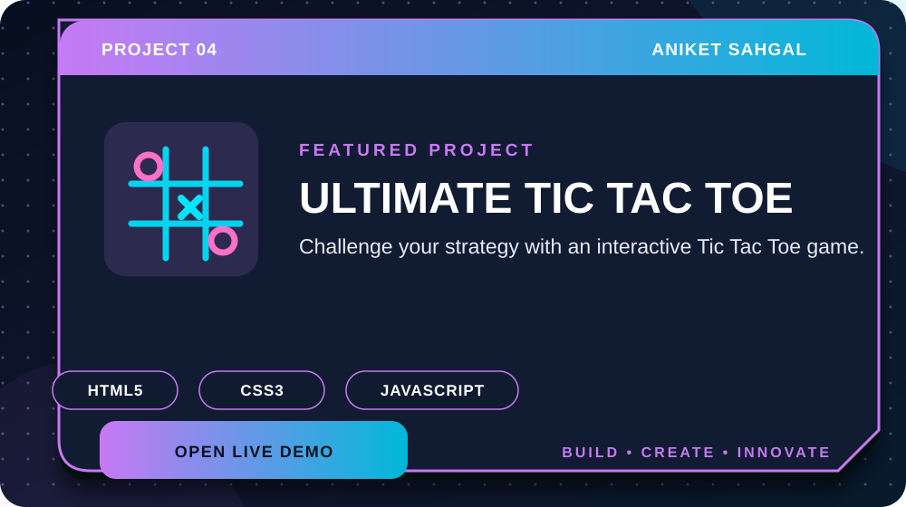

</a>

</td>

</tr>

<tr>

<!-- PROJECT 05 : PREMIUM SUDOKU -->

<td width="50%" align="center">

<a href="https://sehgal1001.github.io/premium-sudoku-game/">

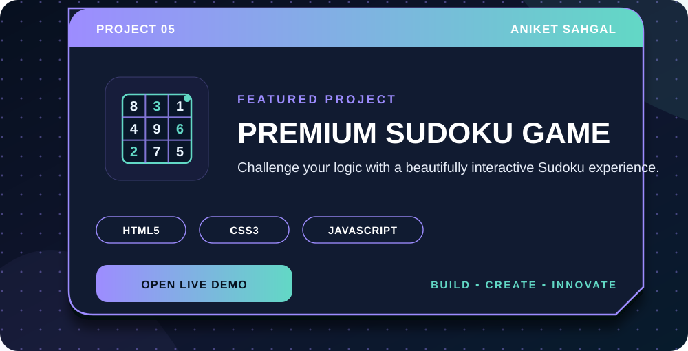

</a>

</td>

<!-- PROJECT 06 : PERSONAL PORTFOLIO -->

<td width="50%" align="center">

<a href="https://sehgal1001.github.io/Portfolio/">


</a>

</td>

</tr>

<tr>

<!-- PROJECT 07 : AI CHATBOT -->

<td width="50%" align="center">

<a href="https://chatbot-aniket.vercel.app/">

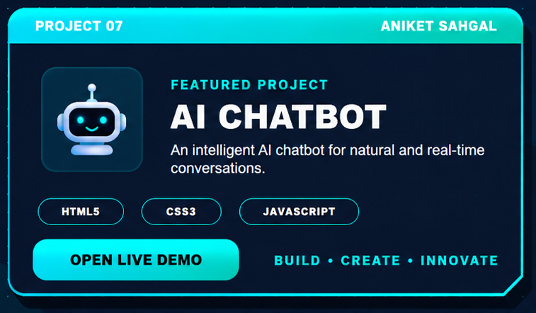

</a>

</td>

<!-- PROJECT 08 : EXAMPRO -->

<td width="50%" align="center">

<a href="https://sehgal1001.github.io/ExamPro/">

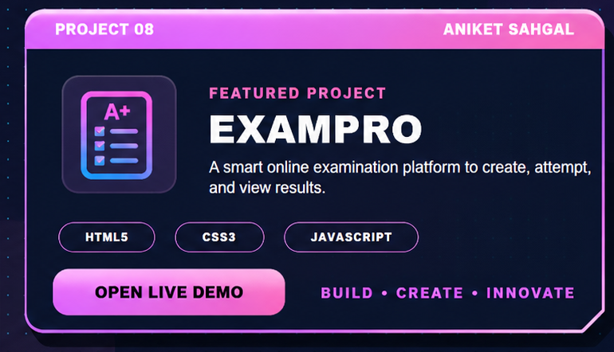

</a>

</td>

</tr>

<tr>

<!-- PROJECT 09 : PYTHON HEART ANIMATION -->

<td width="50%" align="center">

<a href="https://sehgal1001.github.io/python-heart-animation/">

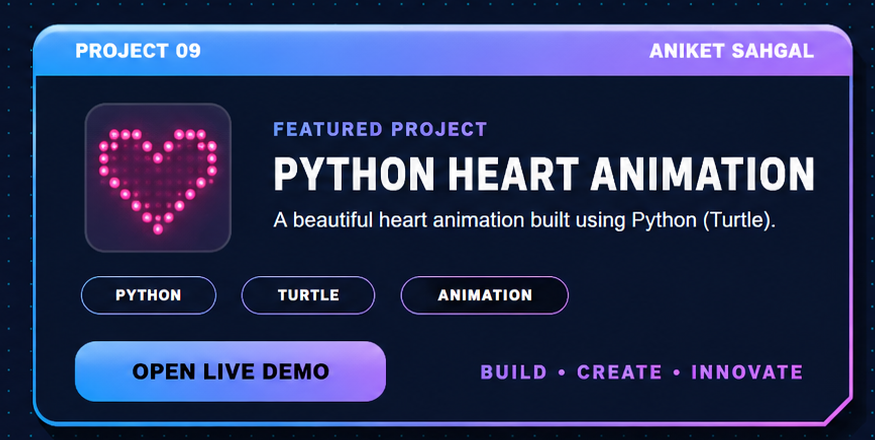

</a>

</td>

<!-- PROJECT 10 : FINTRACK -->

<td width="50%" align="center">

<a href="https://github.com/Sehgal1001">

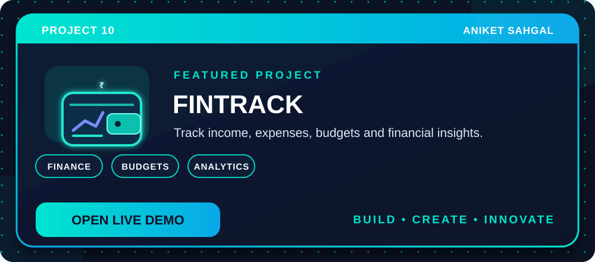

</a>

</td>

</tr>

<tr>

<!-- PROJECT 11 : SCHOOL ERP -->

<td width="50%" align="center">

<a href="https://github.com/Sehgal1001">

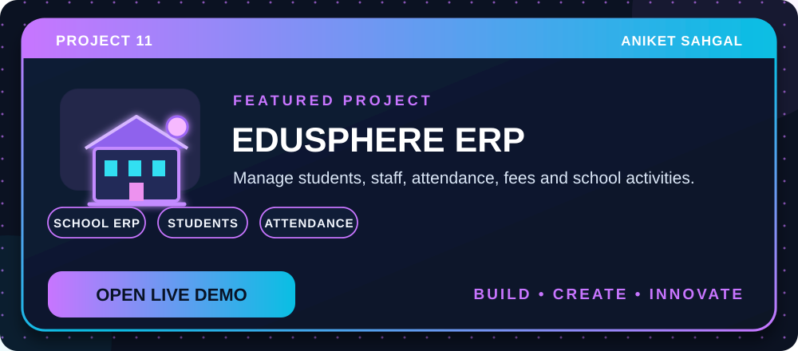

</a>

</td>

<!-- PROJECT 12 : CRYSTALIZED PARTICLE SPHERE -->

<td width="50%" align="center">

<a href="https://sehgal1001.github.io/Crystalized-Ball-Interactive-Particle-Sphere/">

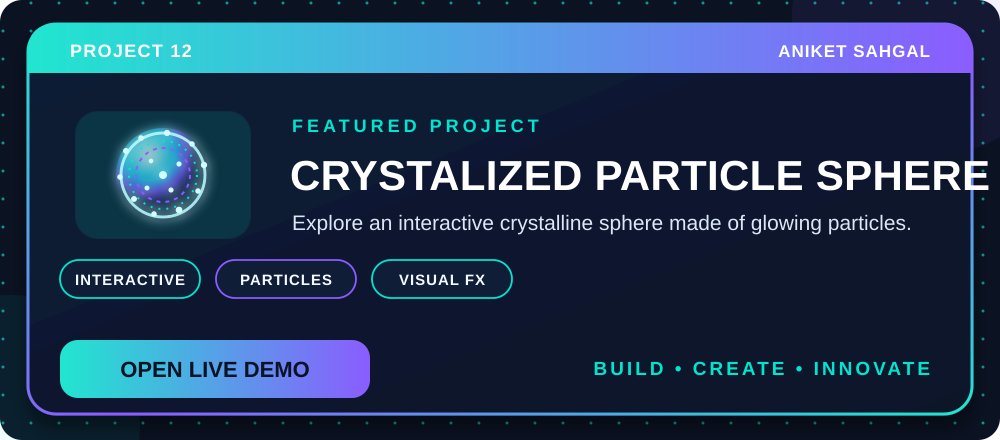

</a>

</td>

</tr>
</table>

<br/>

<a href="https://github.com/Sehgal1001?tab=repositories">

</a>

<br/><br/>

<b>✦ PLAN · BUILD · TEST · IMPROVE ✦</b>

</div>

---

<!-- ================= GITHUB DASHBOARD ================= -->

<h2 align="center">📊 GITHUB DASHBOARD</h2>

<p align="center">
<i>A snapshot of my public GitHub activity.</i>
</p>

<div align="center">

<a href="https://github.com/Sehgal1001">


</a>

<a href="https://github.com/Sehgal1001">


</a>

<br/><br/>


</div>

---

<!-- ================= CONTRIBUTION ACTIVITY GRAPH ================= -->

<h2 align="center">📈 CONTRIBUTION ACTIVITY</h2>

<div align="center">


</div>

---

<!-- ================= CONTRIBUTION SNAKE ================= -->

<h2 align="center">🐍 CONTRIBUTION SNAKE</h2>

<div align="center">


</div>

---

<!-- ================= DEVELOPER TERMINAL ================= -->

<h2 align="center">⌨️ DEVELOPER TERMINAL</h2>

<div align="center">


</div>

```bash
╭────────────────────────────────────────────╮
│             ANIKET'S TERMINAL            │
╰────────────────────────────────────────────╯

$ whoami
> Aniket Sahgal

$ role
> Full Stack Developer | CSE Student

$ frontend
> HTML | CSS | JavaScript | React

$ backend
> Node.js | Express.js

$ databases
> MongoDB | MySQL

$ toolkit
> Git | GitHub | VS Code | Postman
