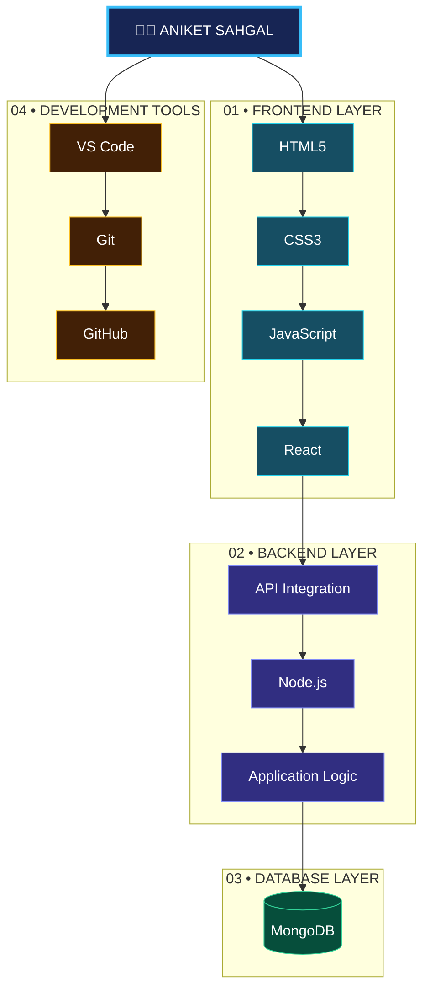

### ◈ ━━━━━━━━━━━━━━━━━━━━━━━━━━━━━ ◈

**CODE • CREATE • INNOVATE • REPEAT**

`△` `⬡` `◇` `○` `◉` `◇` `⬡` `△`

---

## 👨‍💻 ABOUT ME

Hello! I'm **Aniket Sahgal**, a Computer Science Engineering student and aspiring Full Stack Developer passionate about building modern, responsive and interactive web applications.

- 🎓 B.Tech Computer Science Engineering (2022–2026)
- 💻 Interested in Full Stack Web Development
- 🌱 Exploring modern web technologies
- 🚀 Building real-world development projects
- 🎯 Improving problem-solving and programming skills
- ⚡ Passionate about learning and creating new things

---

## ⚙️ MY TECHNICAL ECOSYSTEM

### System Architecture

---

## 🛠️ LANGUAGES & TOOLS

### 💻 Programming Languages

### 🌐 Frontend Development

### ⚙️ Backend Development

### 🗄️ Database

### 🔧 Development Tools

---

## 🚀 FEATURED PROJECTS

### 🌦️ Weather Forecast

A weather forecasting web application built using JavaScript.

- Dynamic weather information
- Interactive user interface
- Responsive design

### 🍔 Food Recipe

A responsive food recipe website built using HTML, CSS and JavaScript.

- Categorized recipe layout
- Search and explore recipes
- Clean user interface

---

## 📊 GITHUB ANALYTICS

---

## 🤝 CONNECT WITH ME

---

### ◈ ALWAYS LEARNING. ALWAYS BUILDING. ◈

**⭐ Open to collaborations, internships and exciting development opportunities.**

`△` ━━━━━━━━━━━━━━━━━━━━━━━━━━━━━ `⬡`

