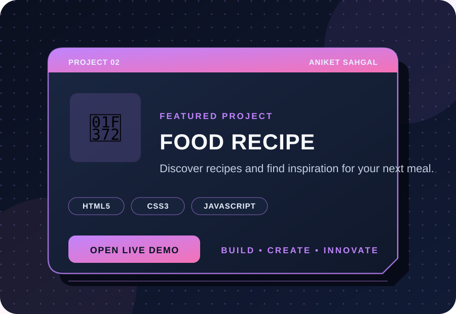
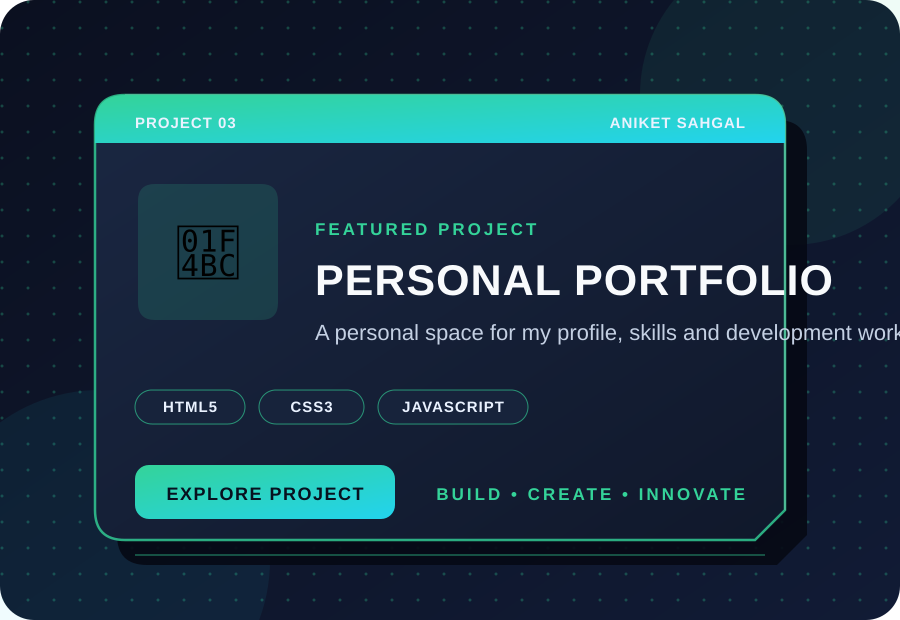

<!-- =============== 3D-STYLE FEATURED PROJECT CARDS =============== -->

<h2 align="center">🚀 FEATURED PROJECTS</h2>

  <i>A collection of ideas turned into digital experiences.</i>

<table>
  <tr>
    <td width="50%" align="center">
      
    </td>
    <td width="50%" align="center">
      
    </td>
  </tr>
  <tr>
    <td colspan="2" align="center">
      
    </td>
  </tr>
</table>

 

  
<b>✦ DESIGN · DEVELOP · DEPLOY ✦</b>

<!-- =============== END PROJECT CARDS =============== -->
